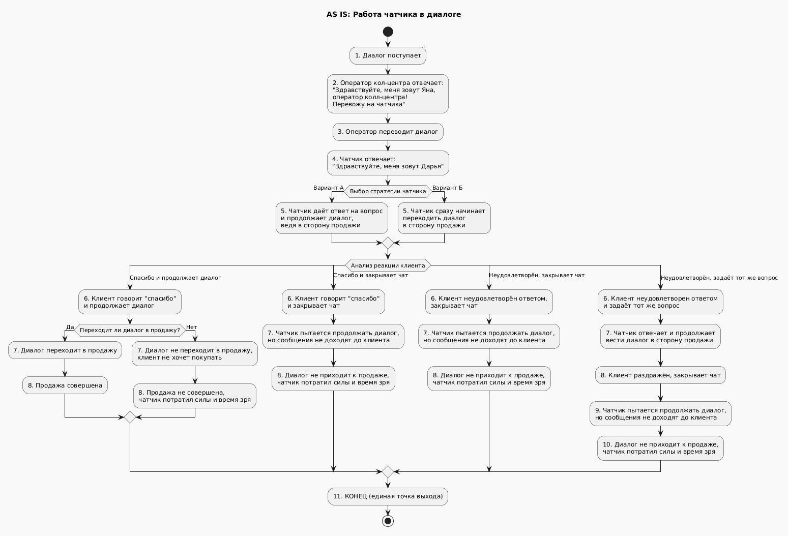
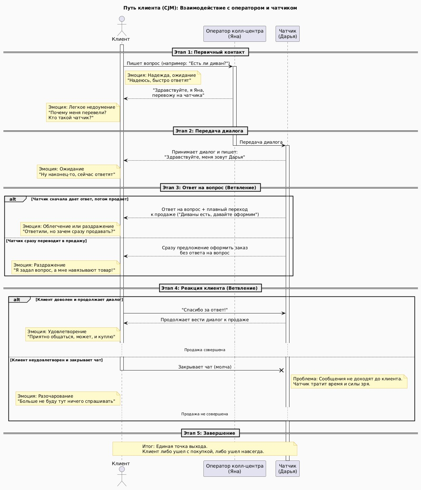
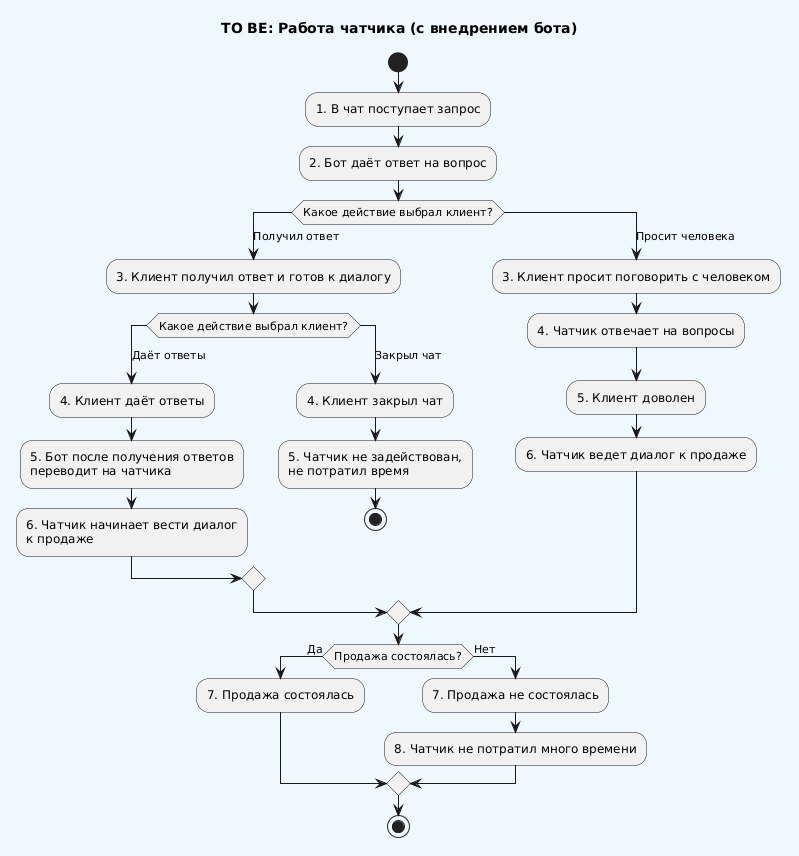
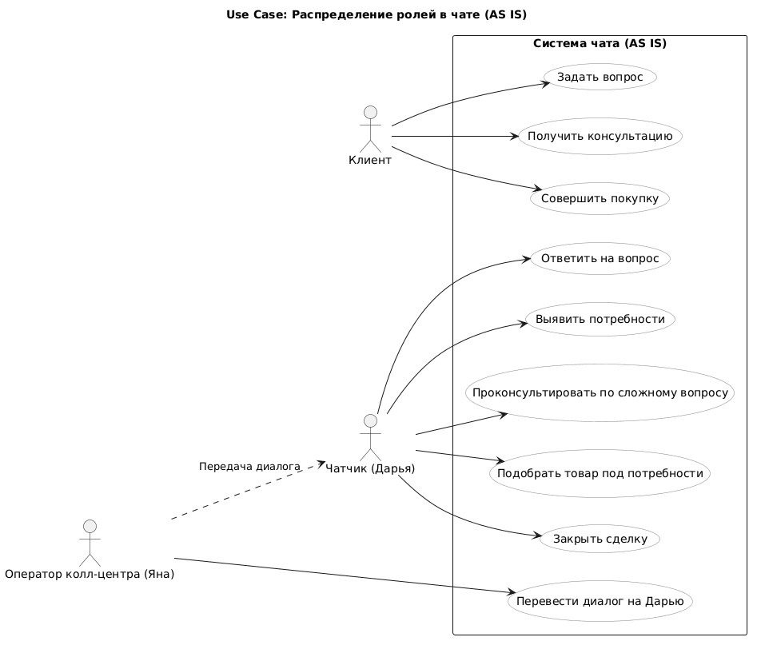
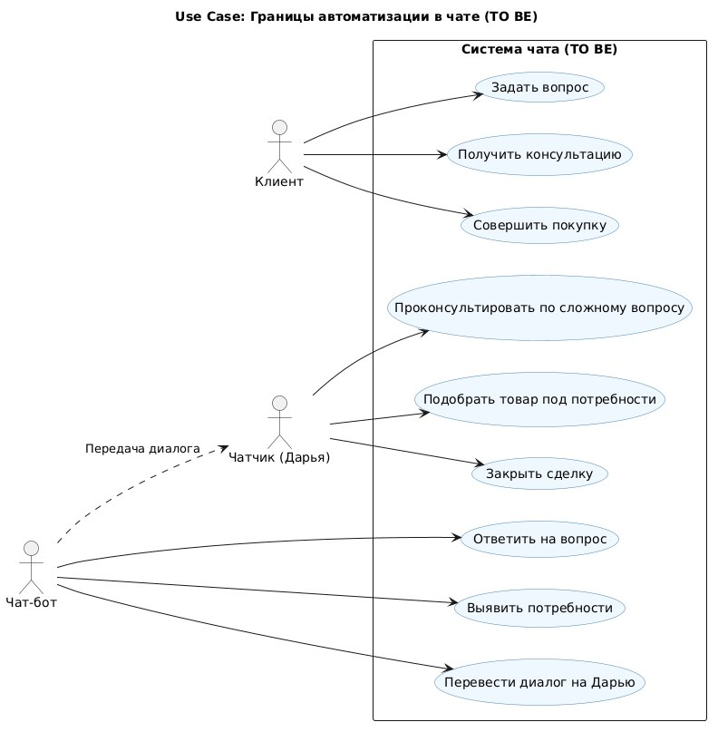

# Пет-проект: Оптимизация обработки обращений в чате интернет-магазина мебели

**Автор:** Ныркова Екатерина  
**Роль:** системный аналитик (junior)  
**Инструменты:** UML Activity, Sequence, Use Case

---

## О проекте за 30 секунд

Я описала реальный процесс коммуникации менеджеров с клиентами в чате интернет-магазина мебели, выявила 5 ключевых проблем (AS IS), предложила целевой процесс с внедрением чат-бота (TO BE) и обосновала экономическую эффективность решения для бизнеса.

**Навыки, которые я показала:**
- декомпозиция процесса коммуникации
- выявление узких мест и их влияния на бизнес
- моделирование AS IS и TO BE с помощью Activity и Sequence
- проектирование Use Case с разграничением ролей
- анализ «как есть → как должно быть» с точки зрения бизнеса

---

## Ключевые артефакты

### Текущий процесс (AS IS)

*Схема текущего процесса: рутина на чатчике, лишнее звено — оператор.*

### Эмоциональный путь клиента (Sequence AS IS)

*CJM: как клиент воспринимает текущий процесс.*

### Целевой процесс (TO BE)

*Схема целевого процесса: бот забирает рутину, чатчик закрывает сделку.*

### Распределение ролей до и после

*AS IS: Дарья делает всё, Яна переводит.*

*TO BE: Бот делает рутину, Дарья — только продажи.*

---

## Документация

- [Полный текст кейса (Markdown)](./docs/analysis.md)
- [Полный текст кейса (PDF)](./docs/оптимизация%20чатов.pdf)

---

## Ключевые результаты для бизнеса

- Снижение нагрузки на менеджера за счёт автоматизации рутины.
- Исключение холостых диалогов (когда клиент закрыл чат).
- Повышение конверсии в продажу за счёт работы с «горячими» лидами.
- Возможность масштабирования без роста штата.
